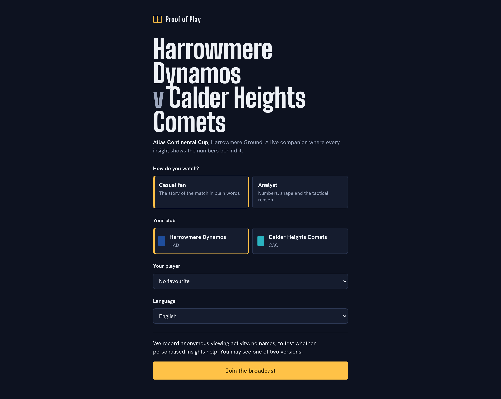
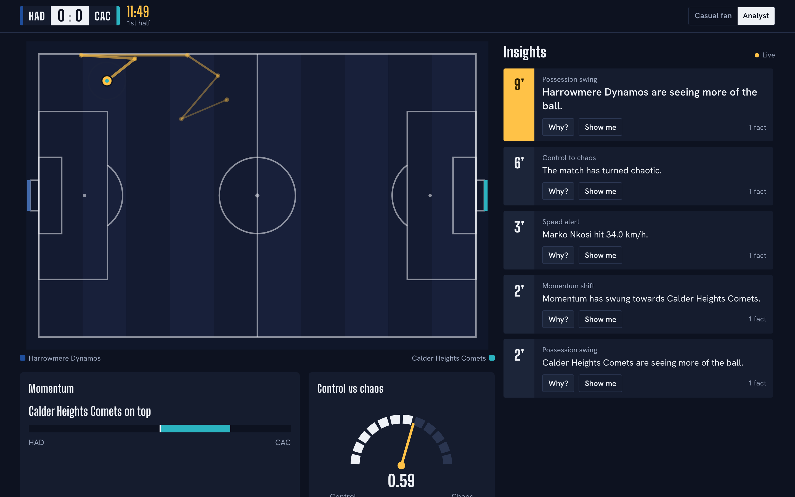
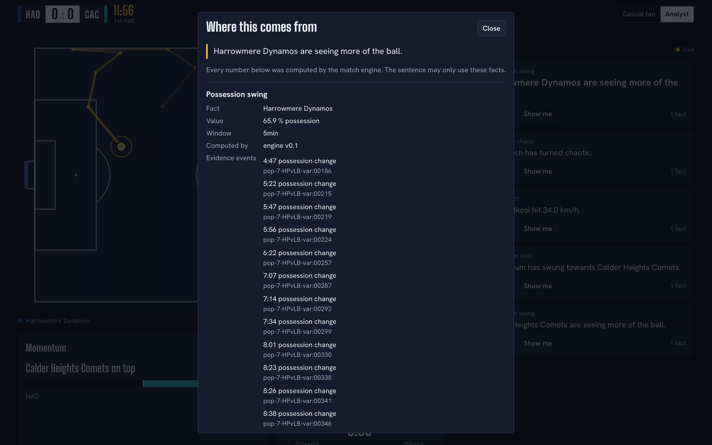
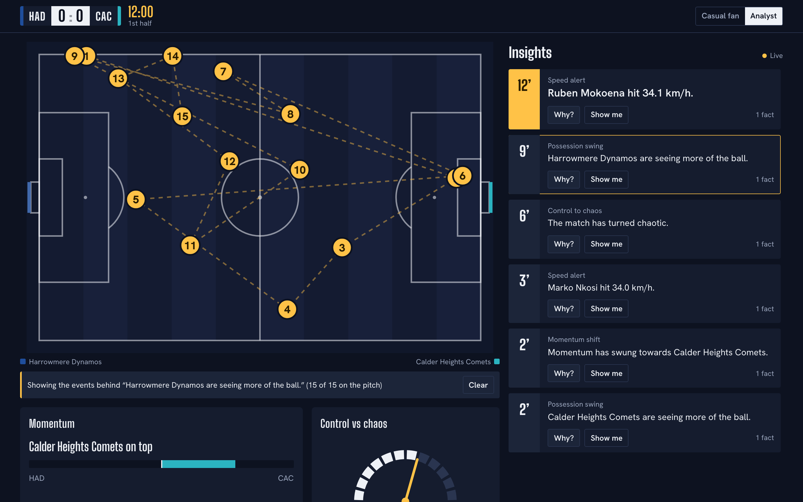
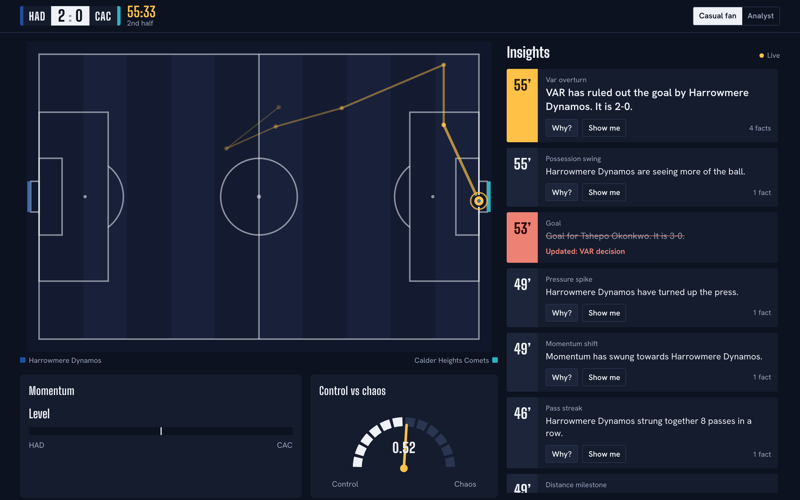
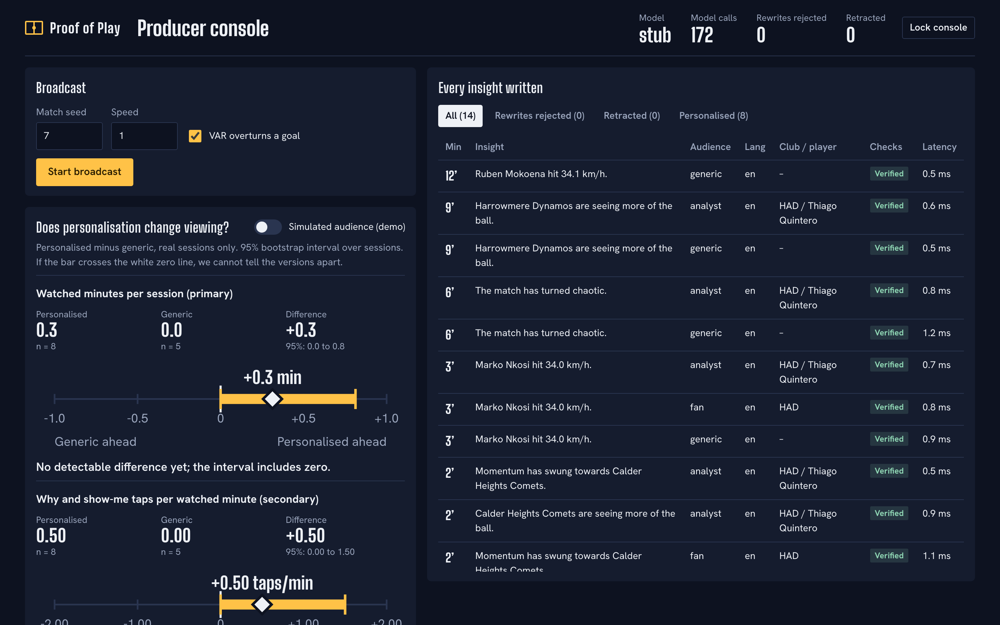

# Proof of Play

**Every broadcast says personalisation works. Ours proves it.**

**[Watch the demo (under 2 minutes)](https://youtu.be/--_7Nwqjcp8)** · **[Try it live](https://pop-app.redsmoke-8822b6f2.southafricanorth.azurecontainerapps.io)**

A live match companion that explains football with verified numbers, personalises them for each viewer, and runs a randomised experiment to measure whether the personalisation changes how people watch.

Built for the Microsoft x Premier League "Inside the Game: Developer Hackathon", challenge: The Synthetic Match Insights Engine for Premier League Studio. All clubs, players, venues and matches are fictional and generated by our own simulator.

## What it does

A seeded simulator plays a fictional match in real time, and a deterministic engine turns every event into stats, facts and key moments. A model on Microsoft Foundry rewrites each moment for the viewer's mode, club, player and language, and a code Verifier rejects any sentence that uses a number or name the facts do not support. Every viewer is randomly assigned to a personalised or a generic insight layer on the same match, and the producer console shows the difference in watched minutes with a 95% interval.

## For judges

**Live app: [pop-app.redsmoke-8822b6f2.southafricanorth.azurecontainerapps.io](https://pop-app.redsmoke-8822b6f2.southafricanorth.azurecontainerapps.io)** (producer console at [/producer](https://pop-app.redsmoke-8822b6f2.southafricanorth.azurecontainerapps.io/producer)). It runs in judging mode until the judging period ends on 10 November 2026: no login and no key.

1. Open the link, choose how you watch (casual fan or analyst), a club, a player and a language, and join. A fictional match is always live. Matches replay back to back at 10x speed.
2. Tap **Why?** on any insight card to see the facts and match events behind it, and **Show me** to light them up on the pitch.
3. Wait for the VAR overturn, which comes round in every match. The score corrects and every insight built on the goal leaves the screen, marked "Updated: VAR decision".
4. Open `/producer` on the same address. It is read-only in judging mode. You'll see the insight log with each insight's agent trace, the live system band, and the experiment readout.
5. Join a second time in another language, for example isiZulu or Spanish, to compare two viewers side by side.

Your sessions go to a separate data set from our pre-registered watch-along, so they do not change the published result.

## Screenshots

| Join | Live | Why? |
|---|---|---|
|  |  |  |

| Show me | VAR retraction | Producer console |
|---|---|---|
|  |  |  |

Phone width: [live](web/screenshots/m390-live.png), [join](web/screenshots/m390-join.png), [why](web/screenshots/m390-why.png). Simulated-audience readout, clearly watermarked: [producer, simulated](web/screenshots/d1440-producer-simulated.png).

## How it maps to the challenge

The five stages of the brief:

| Stage | How Proof of Play does it | Code |
|---|---|---|
| Ingest | The simulator publishes each event to Azure Event Hubs, keyed by match so order holds. The broadcast consumes them back and applies each exactly once, in sequence. If the hub stalls for 3 seconds a watchdog applies the event from a local buffer, so the match never stops | `src/pop/sim/`, `src/pop/api/ingest.py` |
| Interpret | An incremental engine builds state, facts with evidence, and moments with importance scores | `src/pop/engine/` |
| Explain | Six agents on Microsoft Agent Framework. An Interpreter frames the moment, a Writer and an Editor rewrite a grounded draft, a Verifier checks every number and name, and a Fallback and Publisher close it out. Every card has a "Why?" panel with its facts and source events. In the producer console, every insight opens its agent trace step by step | `src/pop/agents/orchestrator.py` |
| Render | Insight cards beside a live pitch, scoreboard and gauges, fed from `/api/feed` and a server-sent event stream. Timed broadcast overlays (lower third, corner, full screen) come from `/api/overlays` for a graphics system to play out | `web/src/viewer/`, `src/pop/api/broadcast.py` |
| Personalise | Casual fan or analyst, favourite club, favourite player, and English, isiZulu, Kiswahili or Spanish | `src/pop/agents/explainer.py`, `src/pop/api/broadcast.py` |

The suggested features:

| Feature | Status | Where |
|---|---|---|
| Player identification with speed and distance thresholds | Built. Per-minute tracking events; tags for top speed over 33 km/h and 5 km and 10 km covered | `player_tracking` in `src/pop/sim/match.py`, `src/pop/engine/config.py` |
| Pass quality: distance, accuracy, difficulty | Built. Pass accuracy per team, pass difficulty from length, angle and pressure, pass streaks | `src/pop/engine/models.py` |
| Speed: ball and shot speed | Built. Shot speed facts and a "rocket shot" moment over 110 km/h | `src/pop/engine/core.py` |
| Narratives, player context, milestones | Built. Moment narratives, player milestones, and half-time and full-time recaps built only from facts the engine still stands behind after any VAR change | `src/pop/agents/`, `src/pop/api/broadcast.py` |
| Explainability: control vs chaos, pressure, rhythm | Built. Momentum, pressing intensity and a control-versus-chaos index, each raising moments when they cross a threshold | `src/pop/engine/core.py` |
| Data innovation | Built. A seeded synthetic match generator with team styles, game-state shifts and a VAR overturn hook. The same seed replays byte for byte | `src/pop/sim/` |
| Multi-language storytelling | Built through the model and a written style guide with football vocabulary per language. UI labels in isiZulu and Kiswahili still need a native speaker's review | `src/pop/agents/style_guide.py`, `web/src/lib/i18n.ts` |
| Auto-eventing from video | Not built | |

## Three things that make it different

**1. Numbers come from code. Words come from AI.** The engine is the only source of numbers. The model is handed a grounded draft and the facts, and asked to rephrase them. The Verifier is plain code with no model in it. It rejects any sentence with a number, player or team that the cited facts do not support. When a rewrite fails, or the model times out or refuses, the viewer gets the grounded draft instead. A model problem can delay the words, and a false number still never reaches the screen.

**2. Live retraction on a VAR overturn.** When VAR rules out a goal, the engine annuls the shot, corrects the score and xG, and retracts every fact and moment built on it. Every insight that cited those facts leaves the screen, marked "Updated: VAR decision". The viewer never keeps a sentence about a goal that no longer counts.

**3. A randomised holdout that measures the personalisation.** Each viewer who consents is assigned once, at random, to personalised or generic insights on the same match, clock and facts. The primary metric is watched minutes per session. The readout is the difference in means with a 95% bootstrap interval, and the analysis plan was written down before the watch-along in [docs/PREREG.md](docs/PREREG.md). We publish the result whatever it is, including no difference. The live result is in [docs/RESULT.md](docs/RESULT.md): the system ran a full match without a fault, and with 7 viewers the experiment was too small to call.

## Architecture

Simulator, Event Hubs, engine, moments, a worker pool running the agent pipeline, the Verifier, a cache, then a per-arm feed to each viewer. The match clock never waits for a model. Diagrams and detail: [docs/ARCHITECTURE.md](docs/ARCHITECTURE.md).

## Microsoft and Azure technologies used

| Technology | What it does here |
|---|---|
| Microsoft Foundry, gpt-4.1-mini | Writes the personalised insight text. Called with Entra ID through the app's managed identity. Local auth is disabled on the Foundry resource |
| Azure Container Apps | Runs the API and serves the built web app from the same origin |
| Azure Container Registry | Holds the image. The app pulls it with its managed identity |
| Azure Cosmos DB (serverless) | Durable engagement log for the experiment. Writes go through a background thread, the log rehydrates on restart, and documents expire after 30 days |
| Azure Event Hubs | The ingest stage. Every match event goes through the `match-events` hub with managed identity. In a full cloud match all 4,267 events came back through the hub with none needing the fallback |
| Microsoft Agent Framework | Orchestrates the six-agent moment pipeline. The Writer and Editor are framework agents; the Verifier stays plain code |
| Log Analytics | Container Apps logs |
| Bicep | All of the above in one template: [infra/main.bicep](infra/main.bicep) |

Claude Sonnet 5.5 on Microsoft Foundry is also coded as a second backend (`POP_LLM=claude`, Entra ID auth, prompt caching on the style guide). It is not in the Bicep template yet and is waiting on model quota. The demo runs on gpt-4.1-mini.

## Quality and assurance

[docs/ASSURANCE.md](docs/ASSURANCE.md) is generated by `scripts/assurance.py`, which runs every check fresh: Python tests, lint, a secret scan, a scan for real Premier League club names in product code, web tests and the web production build. Two house rules apply. A skipped test counts as a failure. The builder of a component never certifies it; a separate checker does.

Tests cover the invariants in [docs/SPEC.md](docs/SPEC.md): byte-identical replays, score equals goals minus overturned goals, all indices in range, no published insight citing a retracted fact, stable and balanced arm assignment, and a match clock that never waits for the model.

## Path to production

Proof of Play was built so a studio could put AI-written insight on air without risking a false number. Here is what already works at production standard, and what a broadcaster would add.

**Already production-grade**

- **No false numbers on air.** Every figure comes from the engine. The Verifier is plain code, and when a rewrite fails the viewer sees the grounded draft. A model outage slows the words down and never stops the match.
- **Corrections propagate.** A VAR overturn retracts every fact and insight built on the goal, live.
- **Every sentence is auditable.** Each insight carries the facts it cites, its source events and a step-by-step agent trace in the producer console.
- **No keys.** Managed identity for Foundry, Cosmos DB, Event Hubs and the registry, with local auth switched off. Infrastructure is one Bicep template.
- **Privacy by design.** Anonymous sessions, explicit consent, a 30-day automatic delete, and the experiment arm never reaches the browser.
- **One command checks everything.** `scripts/assurance.py` runs the tests, lint, a secret scan, a scan for real club names and the production build, and writes the report. A skipped test counts as a failure.
- **Predictable cost.** About US$0.05 of model spend for a full match, with 75% of model input served from cache. Model calls scale with moments and distinct viewer profiles, not with the number of viewers, because viewers with the same profile share one call.

**What a studio would add, in order**

| Step | Change | What stays the same |
|---|---|---|
| 1. Real data | An adapter that maps the provider's live event feed onto our event schema ([SPEC.md](docs/SPEC.md)) and publishes to the same Event Hub | Engine, agents, Verifier, viewer app |
| 2. Scale out | One broadcast worker per match (Event Hubs already partitions by match id). The insight cache and feeds move to a shared store, and the API runs as many stateless replicas | The pipeline and its tests |
| 3. Sign-in | Entra ID sign-in for the producer console through Container Apps built-in authentication, with producer and read-only roles, replacing the shared key | Rate limits, consent, the 30-day delete |
| 4. Languages | Native-speaker review of the style guide and the UI labels for each market before air | The Verifier, which checks numbers and names in any language |
| 5. Operations | Log Analytics alerts on Verifier rejection rate, write lag and model failures. Run the assurance script in CI on every release | The producer console's live system band |
| 6. Measure at scale | Run the same pre-registered holdout on a real audience. 150 sessions per arm detects a difference of 6 to 7 watched minutes ([PREREG.md](docs/PREREG.md)), which one televised match reaches easily | Assignment, blinding, the readout |

**Known limits today**

- It runs as one replica. A restart keeps the engagement log in Cosmos DB, but the match has to be started again.
- The producer console uses a shared key, not sign-in.
- The isiZulu and Kiswahili UI labels have not had a native speaker's review, and nor has the model's wording. Some isiZulu sentences render a five-minute window as "five years". The Verifier checks numbers and names, not word choice, so these pass: a style-guide fix and a native-speaker review come before air.
- Our live experiment had 7 viewers, too few to measure an effect. It proves the method works end to end, not the size of the effect.

## Run it locally

Needs Python 3.12+, [uv](https://docs.astral.sh/uv/) and Node 22. No cloud account needed: the default model is an offline stub.

```bash
# terminal 1: the API
POP_EXPERIMENT_SEED=dev POP_ADMIN_KEY=dev uv run uvicorn pop.api.app:app --port 8000

# terminal 2: the web app
cd web && npm install && npm run dev
```

1. Open http://localhost:5173/producer, enter the key `dev`, and start the broadcast.
2. Open http://localhost:5173 in another tab, choose how you watch, and join.

The offline stub returns the grounded English draft, so isiZulu, Kiswahili and Spanish insights need a real model (`POP_LLM=foundry` with `AZURE_AI_PROJECT_ENDPOINT` and `AZURE_AI_MODEL_DEPLOYMENT`). To watch the Verifier catch an invented statistic, start the API with `POP_DEMO_CHAOS=0.3`; the producer log shows each rejected rewrite and why. The producer start control sets the match speed, so a full match can run in a few minutes.

Tests: `uv run pytest` and `cd web && npm test`. Full report: `uv run python scripts/assurance.py`.

## Deploy to Azure

```bash
az group create -n pop-hackathon-rg -l southafricanorth

# 1. infrastructure (the app starts on a placeholder image)
az deployment group create -g pop-hackathon-rg -f infra/main.bicep \
  -p prefix=pop adminKey=<producer-key> experimentSeed=<long-random-seed>

# 2. build and roll out an image. The script refuses a dirty tree, stops if the build fails,
#    and waits until the new revision is healthy. Secrets come from ~/.config/proof-of-play/secrets.env.
scripts/deploy.sh v1 watchalong
```

For judging, `scripts/deploy.sh v1 engagement 30 judging` makes the producer console readable without a key and replays matches back to back at 10x, so a judge always finds one live. Starting a match by hand is switched off in that mode, and the script refuses to combine it with the `watchalong` container.

`cosmosContainer` keeps data sets apart: `loadtest` for load tests, `watchalong` for the real experiment. The load-test script refuses to run against any other container.

The app runs as one replica on purpose. The live broadcast lives in one process, and Cosmos DB holds the engagement log. After a restart the log comes back from Cosmos and the match is started again from the producer console.

## Privacy and ethics

- Viewers join only after consenting. The join screen says activity is recorded anonymously and that they may see one of two versions.
- A session is a random ID, timestamps and taps. No names, emails, device fingerprints or location.
- The arm is never sent to the browser. Insight IDs in the feed are opaque, so they reveal nothing about audience, club, player or language.
- The engagement log deletes itself after 30 days through the Cosmos DB container TTL.
- Synthetic data only. No real Premier League clubs, players, badges, data, footage or likeness anywhere in the product. The assurance run scans for real club names.
- Simulated audiences carry `SIM-` IDs, live in a separate log, and are watermarked SIMULATED in the console. They never mix with real sessions.

## Responsible AI

- Numbers from code, words from AI. The model never computes a figure.
- Every insight cites the fact IDs it uses, and "Why?" shows those facts and the match events behind them.
- Failures fall back to grounded text. A rejected rewrite, a timeout or a refusal publishes the template draft, which is true by construction.
- The producer console logs every published sentence, whether the model's rewrite passed, and the Verifier's reason when it did not.
- The chaos switch (`POP_DEMO_CHAOS`) exists only to show the Verifier working. It is off by default and is never on for the real watch-along.

## Licence

MIT. See [LICENSE](LICENSE).

Built by Pot Labs, Johannesburg.
