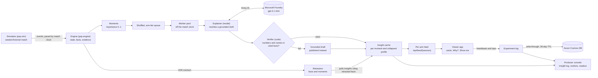
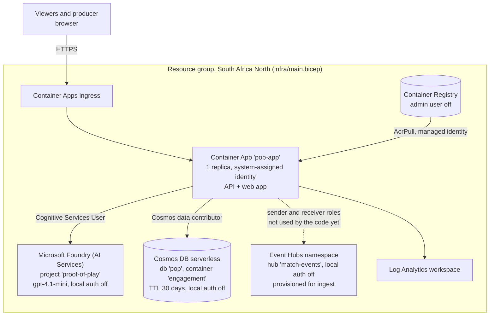

# Architecture

Proof of Play is one Python service (FastAPI) and one web app (Vite, React, TypeScript). In Azure they ship as a single container: the API serves the built web app from the same origin.

## Pipeline

## Deployment, Azure South Africa North

The resource group's location sets the region for every resource. We create it in `southafricanorth`.

## The engine

`pop.engine.Engine` consumes one event at a time and never looks ahead. It is the only source of numbers in the product.

- **State.** Score, time-weighted possession, final-third share, passes and pass accuracy, xG, shots, pressing intensity, momentum (-1 to +1), a control-versus-chaos index (0 to 1), and per-player stats including top speed and distance.
- **Facts.** Atomic, checkable statements: `goal`, `score`, `xg_team`, `xg_player`, `shot_speed`, `big_chance_missed`, `momentum_shift`, `pressure_spike`, `control_to_chaos`, `chaos_to_control`, `possession_swing`, `pass_streak`, `player_top_speed_alert`, `player_distance_milestone`, `red_card`, `var_overturn`. Each fact carries its value, unit, window and **evidence**: the IDs of the match events it was computed from.
- **Moments.** A detected key moment with an importance score and the facts behind it. Thresholds, windows and minimum sample sizes live in `pop/engine/config.py`.
- **Models.** xG and pass difficulty are small geometric models written from first principles, bounded 0 to 1 and tested for monotonicity.
- **Retraction.** On a VAR overturn the engine annuls the shot (score, shots, on target, xG), retracts every fact whose evidence includes it and every moment built on those facts, and emits corrected facts and a `var_overturn` moment. The broadcast then pulls every cached insight that cited a retracted fact, and the viewer's card is marked "Updated: VAR decision" before it leaves.

## The agent pipeline and the failure path

For each moment and each collapsed viewer profile:

1. **Draft.** A template sentence is built from the facts. Numbers are copied, so it is true by construction.
2. **Rewrite.** The model gets the draft, the facts, the audience, language, favourite club and player, and the match minute. Its standing instructions (`pop/agents/style_guide.py`) are a fixed prefix so it can be cached. It may only rephrase.
3. **Verify.** `pop/agents/verifier.py` is deterministic code. It rejects the sentence if it cites no facts or unknown facts, contains a number not found in the cited facts (allowing rounding and shares as percentages), or names a player or team that is not a subject of a cited fact.
4. **Publish or fall back.** A verified rewrite is published. Otherwise the grounded draft is published and the producer log records the reason the rewrite was rejected. A model timeout, rate limit, refusal or empty reply returns nothing, so the draft goes out.

The demo-only `POP_DEMO_CHAOS` switch wraps the model so that a set share of rewrites gain an invented statistic. It exists to show step 3 catching it live.

## How the holdout avoids bias

- **Assignment.** HMAC-SHA256 of a random session ID keyed by a server-side seed, p = 0.5. Stable per session, unpredictable without the seed, never re-randomised. The client cannot choose its arm.
- **Blinding.** The arm is never sent to the browser. Insight IDs in the feed are an HMAC of the internal ID, so they reveal nothing about audience, language, club or player. Retraction messages on the event stream carry only a type and a sequence number.
- **Same match for both arms.** One shared broadcast, one clock, one set of engine facts. Only the insight layer differs.
- **Arm-fair queue.** Model jobs for a moment are shuffled together by a hash, so neither arm reliably gets its sentence first.
- **Server-clock watched minutes.** Watched minutes are the number of distinct 15-second slots in which the server received a heartbeat. Client clocks, match speed and duplicate heartbeats do not move the metric. The browser only sends heartbeats while the page is visible.
- **Profile collapsing.** Club and player framing count only when the moment is about that club or player. Generic viewers collapse to language only. Many viewers share one model call per moment, so personalised viewers do not wait longer because there are more of them.
- **Pre-registration.** The metric, the interval method (5,000 bootstrap resamples, seed 0) and the exclusions are written in [PREREG.md](PREREG.md) before the watch-along. Simulated sessions use `SIM-` IDs in a separate log.

## Scaling

- **Feeds never wait on a model.** Moments are queued to a worker pool (`POP_WORKERS`, default 8) and written in worker threads. A feed request returns only insights already written.
- **The match clock never waits.** The broadcast loop ingests events and queues jobs without awaiting them. A test holds this invariant with a deliberately slow model.
- **Late joiners.** A new profile gets the last 12 moments written for it.
- **Meters.** The producer API (`/api/producer`) reports queue depth, write lag (p50 and p95), model calls, token usage and rejected rewrites. The console shows the rejected-rewrite count and the full insight log.
- **State.** One replica holds the live broadcast in memory. The engagement log writes through to Cosmos DB in a background thread with retries, so a viewer's request never waits on the database, and it rehydrates from Cosmos on start. After a restart the match regenerates from its seed and is started again from the producer console. `scripts/loadtest.py` drives simulated viewers against a deployment. Its viewers join as ordinary sessions, so run it before the real watch-along with `COSMOS_CONTAINER` pointed at a separate container (one the Bicep does not create), then restart on the `engagement` container with a fresh seed before real viewers join.

## Security

- **Managed identity.** The Container App's system-assigned identity holds role assignments for Foundry, Cosmos DB, Event Hubs and the registry. Local key auth is disabled on Foundry, Cosmos DB and Event Hubs, and the registry admin user is off. No keys live in the repo or in the app's data path.
- **Secrets.** The producer key and experiment seed are Container Apps secrets passed as secure Bicep parameters.
- **Rate limits.** Joining is limited per client address (30 a minute). The address is the last `X-Forwarded-For` entry, which the Container Apps ingress appends, so a client cannot forge its way around the limit. Engagement events are limited per session (120 a minute).
- **Producer key.** The producer view, the readout and the start control require the `X-Pop-Key` header to match `POP_ADMIN_KEY`.
- **Consent.** The API refuses to create a session without it.
